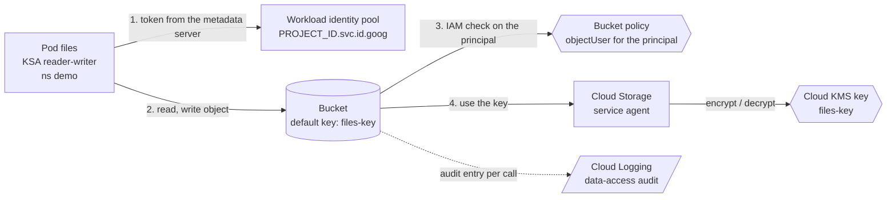

# Architecture

A GKE Autopilot cluster runs a pod that reads and writes a Cloud Storage bucket with no service account key anywhere. The pod authenticates through Workload Identity Federation for GKE, IAM decides what its principal may do on the bucket, and a customer-managed Cloud KMS key decides whether the data can be read at all. Each layer fails with its own error, and a small Python tool, `gke-triage`, tells them apart from the error text or the audit log.

## Components

| Component | Owns | Identity / access |
| --- | --- | --- |
| **Pod** `files` (`manifests/base`, namespace `demo`) | A `google-cloud-cli` container that sleeps, so the owner can run storage commands inside it and see exactly which identity they use. | Kubernetes service account `reader-writer`. No token mounted, no secret, no key file. |
| **Workload identity pool** `PROJECT_ID.svc.id.goog` | Turns a pod's namespace and Kubernetes service account into an IAM principal. Always on in Autopilot. | The principal `principal://iam.googleapis.com/projects/NUMBER/locations/global/workloadIdentityPools/PROJECT_ID.svc.id.goog/subject/ns/demo/sa/reader-writer`. |
| **Bucket** (`modules/cmek-bucket`) | The files. Private, uniform access, versioned, default encryption with the key. | `roles/storage.objectUser` for the pod's principal, on the bucket only. |
| **Key** (`modules/kms-key`) | Key ring `files`, key `files-key`: 90-day rotation, 24-hour destruction window. | `cryptoKeyEncrypterDecrypter` for the **Cloud Storage service agent**, not for the pod. |
| **Cluster** (`modules/gke-autopilot`) and **network** (`modules/network`) | Autopilot, private nodes, API endpoint limited to the ranges you list; a custom VPC and a subnet with Private Google Access so nodes without external addresses can still pull the image and call Google APIs. | None of its own for the pod. |
| **Audit logs** (`modules/audit-logs`) | Data-access audit logs for Cloud Storage, off by default, so denied calls show up in Cloud Logging. | None. |
| **`gke-triage`** (`src/gke_triage`) | Classifies an error text as identity, authorization or key, summarizes the denials in an audit log export, renders the triage table, builds and checks the principal string. | Runs on your machine; reads files and standard input only. |

## Data flow



One request, end to end, and where each failure appears:

1. The pod runs `gcloud storage cp`. The tool asks the metadata server for a token; GKE exchanges the pod's Kubernetes identity for a short-lived Google token whose principal is the one above. **Fails here (identity)** if the cluster has no workload pool or the pod has no usable credentials: the call never carries an identity.
2. The request reaches the bucket with that token. Authentication has succeeded: Google knows which principal is calling.
3. IAM checks whether the principal holds a role with the permission the call needs (`storage.objects.create` for a write, `storage.objects.get` for a read) on the bucket. **Fails here (authorization)** with a 403 that names the principal and the permission. The pod running as `default` (break one) and the pod whose role was removed (break two) both fail here, with different principals or at different times.
4. Cloud Storage encrypts or decrypts the object with the bucket's key, using its own service agent, which holds `cryptoKeyEncrypterDecrypter`. The pod's IAM role is not involved. **Fails here (key)** when the key version is disabled or destroyed, or the service agent loses its role; the 403 names the Cloud KMS key and its state, not the pod's principal (break three).
5. Cloud Audit Logs record each call. With data-access logs on, a denied call has the principal in `protoPayload.authenticationInfo.principalSubject`, the permission in `authorizationInfo[]` and status code 7.

## Pattern: ports and adapters around a small diagnostic tool

The Kubernetes and Terraform parts are declarative; the one program is the triage tool, in four layers enforced by import-linter:

```text
interfaces      cli.py: classify, audit, table, principal, check-binding
infrastructure  JsonAuditLogSource (gcloud logging JSON), DirectoryCaptureSource (captures/*.txt)
application     diagnose, SummarizeDenials, BuildTriageTable; ports CaptureSource, AuditLogSource
domain          WorkloadPrincipal, check_binding_member, classify (Layer, Cause, Finding), AuditDenial
```

The domain and application layers read no files and print nothing (a second import-linter contract forbids `pathlib`, `json`, `argparse` and `subprocess` there), so the classification rules are tested on plain strings taken from the lesson. Ports exist where input comes from outside (log exports, capture files); there is no port for the classifier because it is a pure function.

## Decisions and trade-offs

| Decision | Why | Cost |
| --- | --- | --- |
| **Principal binding on the bucket** (direct WIF principal), not a Google service account to impersonate | Fewer moving parts and no `iam.workloadIdentityUser` binding; the audit log shows the Kubernetes identity. The lesson offers both. | Some Google APIs do not accept federated principals yet; for those, bind a Google service account and annotate the Kubernetes one. |
| **Project number, not id, in the principal** | The principal's `projects/NUMBER` segment is the number; the pool name uses the id. Using the id binds nothing and looks like propagation delay. | `WorkloadPrincipal` rejects a non-numeric number with the fix in the message; Terraform validates the variable; `gke-triage check-binding` tests an existing binding. |
| **The pod holds no role on the key** | Cloud Storage uses its own service agent for the key; a pod role on the key would be unused authority. | A learner may expect to need one; step 2's hint says to test a write before adding anything. |
| **Terraform creates the key before the bucket, and the agent's role before the bucket** | Creating a bucket with a default key fails unless the service agent may already use it. `depends_on = [module.key]` makes the order explicit. | The `google_storage_project_service_account` data source runs at apply time, which is also what creates the agent. |
| **Autopilot with private nodes plus a custom VPC** | Node management is out of the way (the lesson's advice), nodes have no external address, and Private Google Access still lets them pull `gcr.io` images. | A VPC module the lesson does not mention; the API endpoint is public but restricted to your /32. |
| **`automountServiceAccountToken: false`** | WIF for GKE needs the metadata server, not the projected Kubernetes token; not mounting it removes a credential the pod does not need. | `kubectl exec` still works; a pod that must call the Kubernetes API would need it. |
| **Restricted pod security** on the namespace and the pod | The lesson's pod runs `sleep`; there is no reason for it to run as root or write its root filesystem. | The image's home directory is not writable, so `HOME` and `CLOUDSDK_CONFIG` point at an `emptyDir`. |
| **24-hour key destruction window** | The lesson's step 6 says key versions are destroyed after a scheduled period of 24 hours by default; the shortest valid window keeps the sandbox cleanup quick. | Production would use a longer window so a mistaken destroy can be undone. |
| **Captured error texts, classified by regular expressions** | The three failures have recognizably different messages; a rule per message family is easy to read and extend. | Wording changes between tool versions. The rules are tested on the lesson's texts; the key rule matches "Cloud KMS key ... disabled/destroyed" and `cloudkms.*` permission denials, and you should add your own captured text as a fixture. |

## Failure modes the lesson teaches and where the repository shows them

| Failure | Layer | Where to see it |
| --- | --- | --- |
| Default Kubernetes service account | authorization (it authenticated, then no role) | `manifests/overlays/wrong-identity`; `scripts/break-wrong-sa.sh`; `tests/fixtures/wrong-service-account.txt` classified as `default service account`. |
| Role removed from the right identity | authorization | `scripts/break-missing-role.sh`, `scripts/restore-role.sh` (no restart needed); fixture `missing-role.txt`. |
| Key version disabled | key | `scripts/break-key.sh`, `scripts/restore-key.sh`; fixture `key-disabled.txt`. |
| Cloud Storage service agent lacks the key role | key | Fixture `key-access-denied.txt`; the order of resources in `infra/environments/lab/main.tf`. |
| Project id where the number belongs | authorization (binding matches nothing) | `WorkloadPrincipal`, `check_binding_member`, the `var.project_number` validation, and tests for each. |
| No credentials at all | identity | Fixture `no-credentials.txt`. |
| Data-access logs off | (blind spot) | `modules/audit-logs`; without it the Cloud Logging half of step 3 finds nothing. |

## Limits of the teaching build against a production one

- **Nothing here has run on a cluster.** The manifests are schema-validated and rendered with `kubectl kustomize`; the Terraform is validated and planned offline; the classifier is tested on the lesson's texts. The cluster, the real error texts and the audit log entries need the project.
- One region, one project, local Terraform state, a public API endpoint limited to one address.
- Google-managed key protection level `SOFTWARE`, no HSM, no key access justifications, no external key.
- No VPC Service Controls, no organization policy (see the `landing-zone-slice` project), no Binary Authorization on the image, and no network policy: the pod does not serve traffic.
- The audit log configuration is authoritative for Cloud Storage in the project; a shared project would manage it centrally.

## Extending it

- **Rotate the key and show old objects stay readable** (stretch 1): `gcloud kms keys versions create`, set it primary, read `first.txt`, rewrite it, and compare `kms_key` before and after.
- **Restrict the pod to one object prefix** (stretch 2): add an IAM condition to the bucket binding in `modules/cmek-bucket` (`resource.name.startsWith("projects/_/buckets/BUCKET/objects/pod-a/")`) and add a second pod to prove the other prefix is refused.
- **An IAM deny policy** (stretch 3): add a `google_iam_deny_policy` on the project that denies `storage.objects.delete` to everyone except a break-glass group, and test it with the pod's identity.
- **A new failure rule**: add a fixture text, a failing test, then a rule in `gke_triage.domain.triage.classify`.
