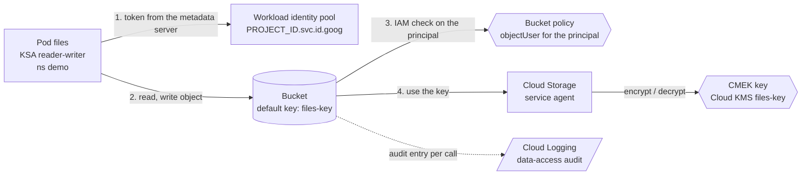

# Mermaid diagrams

## 1. What it is

Mermaid is a small language for drawing diagrams with text. You write boxes and arrows as lines of text inside a Markdown code block marked `mermaid`, and a renderer draws the picture. GitHub renders such blocks in README and other Markdown files automatically. The advantage over a picture file is that the diagram is text: it can be reviewed in a pull request, searched, and kept in step with the code.

## 2. Why this repository uses it

The lesson shows a diagram of the cluster, the bucket and the key, and the repository rule says the lesson's diagram and `ARCHITECTURE.md` must agree on component names. The diagram in `ARCHITECTURE.md` is the repository's version: the pod, the workload identity pool, the bucket, the IAM check, the Cloud Storage service agent, the key and the audit log.

## 3. Where it appears

| Path | What it does |
| --- | --- |
| `ARCHITECTURE.md` | One `mermaid` block in the section "Data flow". |

## 4. How it works underneath

Nothing is installed or run in the repository. When a page is shown, the renderer in your browser (GitHub includes one) reads the block and draws SVG shapes. A diagram starts with its type and direction: `flowchart LR` is a flow chart laid out left to right (`TB` would be top to bottom). After that:

- `id["label"]` declares a node (a box). `id` is a short name used in the lines below; the text in quotes is shown. `<br/>` inside a label is a line break.
- `a --> b` draws an arrow from `a` to `b`. `a -->|text| b` puts text on the arrow. `a -. "text" .-> b` draws a dotted arrow with text.
- `subgraph name["title"] ... end` draws a box around the nodes listed inside.

## 5. Walkthrough of this repository's use

`ARCHITECTURE.md`



- `flowchart LR` sets the type and the direction: left to right.
- `pod["Pod files<br/>KSA reader-writer<br/>ns demo"]` declares the pod (`KSA` is the Kubernetes service account). The first arrow, `-->|1. token from the metadata server| wif[...]`, goes to the workload identity pool; the number in the label is the step.
- `bucket[("Bucket<br/>default key: files-key")]`: the shape `[( )]` is a **cylinder**, Mermaid's symbol for storage.
- `iam{{"Bucket policy<br/>objectUser for the principal"}}` and `kms{{...}}`: `{{ }}` draws a **hexagon**, used here for the two checks (the bucket's policy and the key).
- `gcs_agent["Cloud Storage<br/>service agent"]` is a plain box. The arrows 3 and 4 and the encrypt/decrypt arrow trace how a request is checked: the bucket asks IAM about the principal, then uses the key through the service agent.
- The last arrow, `bucket -.->|audit entry per call| logs[/"Cloud Logging<br/>data-access audit"/]`, is **dotted** (`-.->`) because it is a side effect, and `[/ ... /]` draws a parallelogram for the log.

## 6. Try it yourself

```bash
grep -n -A2 "^flowchart" ARCHITECTURE.md | cut -c1-60
```
Expected: the line number of `flowchart LR` and the next two lines, the `pod[...]` node and the next arrow.

```bash
awk '/^flowchart/,/Cloud Logging/' ARCHITECTURE.md | grep -c -- '-->'
```
Expected: `5`, the number of lines that contain a solid arrow.

Open `ARCHITECTURE.md` on GitHub (or in an editor with a Markdown preview that supports Mermaid) and look at the drawing; then change a label in a copy of the block and watch the picture change.

## 7. Mistakes people make

- **A label with special characters** (quotes, brackets) not wrapped in `"..."`.
- **Reusing a node id** for two different things; the second silently changes the first.
- **A diagram too big to read.** Split it; the steps are numbered in the labels.
- **A diagram that no longer matches the code.** The component names are checked by hand against the lesson's diagram when the repository is built.

## 8. Check yourself

1. How does a Mermaid block start? *Three backticks followed by the word `mermaid`.*
2. What does `TB` mean? *Top to bottom.*
3. How do you label an arrow? *`a -->|text| b`.*
4. What does `subgraph ... end` do? *Draws a box around the nodes inside.*
5. Why keep the diagram as text? *It can be reviewed and changed like code.*

## 9. Further reading

- Mermaid documentation, flowcharts: <https://mermaid.js.org/syntax/flowchart.html>
- GitHub: creating diagrams: <https://docs.github.com/en/get-started/writing-on-github/working-with-advanced-formatting/creating-diagrams>
